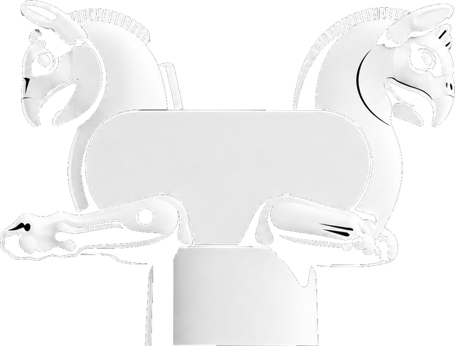
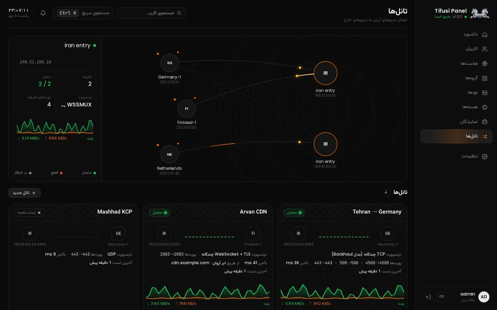

  

<h1 align="center">TIFUSI PANEL</h1>

پنل خودمیزبان برای سرورهای VPN و پروکسی: یک داشبورد برای نودها، کاربران و تانل‌ها.

  
  
  
  
  

  

 <a href="README.md">English</a> &nbsp;·&nbsp;  <b>فارسی</b>

  
    
  

## امکانات

- **همه‌ی پروتکل‌ها روی یک نود**: VLESS + REALITY، VMess، Trojan، Shadowsocks، Hysteria2، WireGuard، IKEv2، L2TP و PPTP.
- **تانل برای ایران**: TCP، TLS، WebSocket، mux، Stealth، KCP، Spoof و CDN، با زنجیره‌ی چندمرحله‌ای.
- **یک لینک اشتراک** برای v2rayNG، Clash، sing-box، آیفون و اپ اندروید تیفوسی.
- **آپدیت امن** که اگر خراب شد خودش برمی‌گردد، و نود جایگزین وقتی یک آی‌پی فیلتر شد.
- **نمایندگان**، محدودیت دستگاه و ربات فروش تلگرام.

نصب و همه‌ی راهنماها در [سایت مستندات](https://javadtifusi-eng.github.io/Tifusi-Panel/fa/) است.

