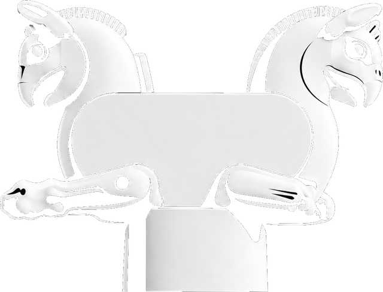

  

<h1 align="center">TIFUSI PANEL</h1>

<b>Manage VPN servers, users and subscriptions with Xray and IKEv2.</b>

  
  
  
  
  

  

 <b>English</b> &nbsp;·&nbsp;  <a href="README.fa.md">فارسی</a> &nbsp;·&nbsp;  <a href="README.ru.md">Русский</a>

  
    
  

