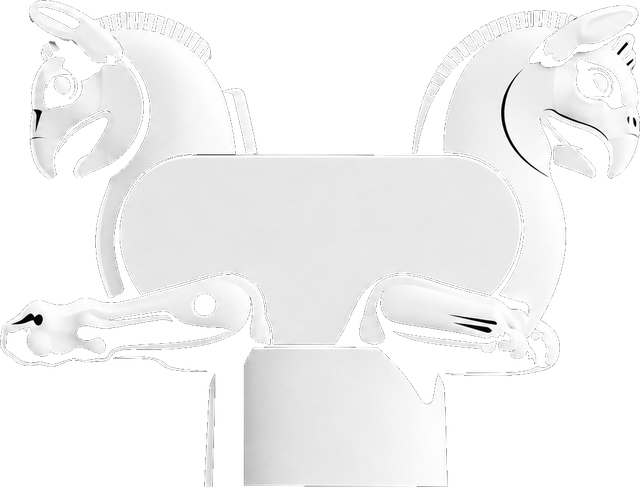
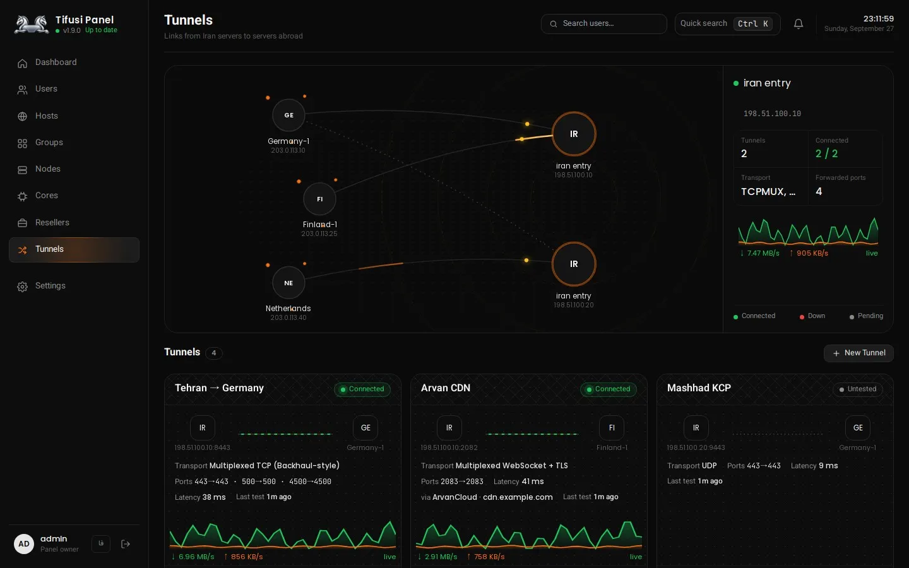

  

<h1 align="center">TIFUSI PANEL</h1>

A self-hosted panel for VPN and proxy servers: one dashboard for nodes, users and tunnels.

  
  
  
  
  

  

 <b>English</b> &nbsp;·&nbsp;  <a href="README.fa.md">فارسی</a>

  
    
  

## What you get

- **Every protocol on one node**: VLESS + REALITY, VMess, Trojan, Shadowsocks, Hysteria2, WireGuard, IKEv2, L2TP and PPTP.
- **Tunnels for Iran**: TCP, TLS, WebSocket, mux, stealth, KCP, spoof and CDN, with multi-hop chains.
- **One subscription link** for v2rayNG, Clash, sing-box, iPhone and the Tifusi Android app.
- **Safe updates** that roll themselves back, and a replacement node when an IP is blocked.
- **Resellers**, device limits and a Telegram sales bot.

Installation and every guide are on the [documentation website](https://javadtifusi-eng.github.io/Tifusi-Panel/en/).
