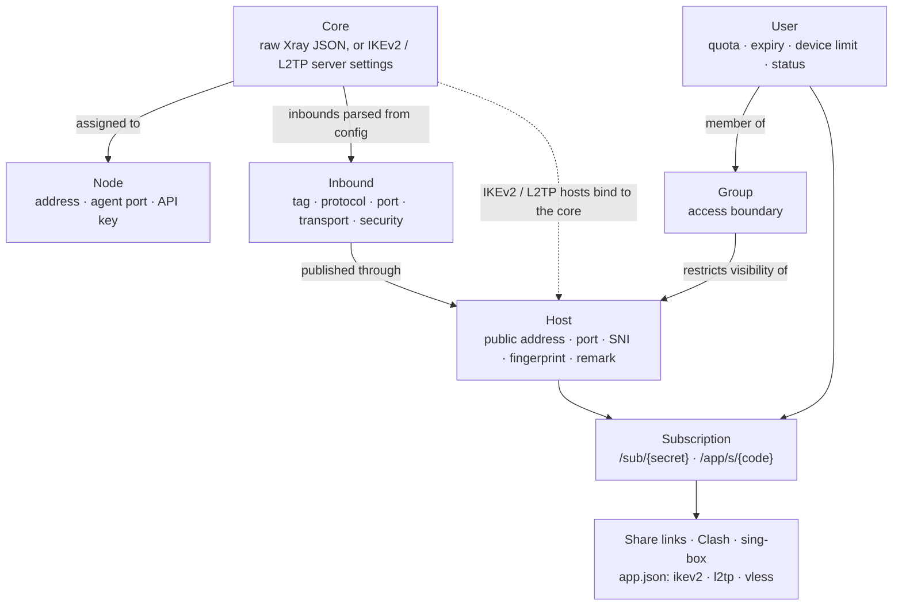

[← README](../../README.md) · 📦 [Installation](installation.md) · 🌐 [Nodes](nodes.md) · ⚛️ **Cores & hosts** · 👤 [Users](users-and-subscriptions.md) · 💼 [Resellers](resellers.md) · 🚇 [Tunnels](tunnels.md) · 🛡️ [Connection Shield](connection-shield.md) · 🔀 [Domain rotation](domain-rotation.md) · ✈️ [Telegram bot](telegram-bot.md) · 📶 [Network health](network-health.md) · 🎛️ [Operations](operations.md) · 🔁 [Safe updates](updates-and-rollback.md) · 🚢 [Deployment](deployment.md) · 📐 [Architecture](architecture.md) · 💻 [Development](development.md)

# Cores, hosts and groups

> **Current default:** Xray protocols and IKEv2. L2TP, PPTP, Hysteria2 and WireGuard references below describe retained code, not services offered by the default deployment. See [Deployment](deployment.md).

## Configuration model

## Cores

A core is the server-side technology a node runs. The default deployment uses these types:

| Type | Content |
| --- | --- |
| `xray` | A complete Xray JSON configuration, exactly what `xray run -c` accepts, with structured editors for routing, outbounds and DNS. Its inbounds are parsed out and become selectable by hosts and groups. |
| `ikev2` | The server parameters of an IKEv2/IPsec deployment: authentication mode (EAP-MSCHAPv2 or PSK), remote ID and server certificate. |

Each core can be assigned to one or more nodes. A node holds one Xray core and one IPsec core at the same time; see [Nodes](nodes.md#two-cores-on-one-node).

A core can't be saved with an inbound (or a Hysteria2 or WireGuard port) on a port something on the node already uses — any node's agent port, SSH (22) or the agent's internal stats APIs; see [Reserved ports](updates-and-rollback.md#reserved-ports).

## Hosts

A host is the public endpoint a client receives: address, port and display name, for VLESS, VMess, Trojan, Shadowsocks, Hysteria2, L2TP and IKEv2.

- **Xray protocols** reference an inbound parsed from the core configuration and inherit transport, security and REALITY parameters from it. SNI, ALPN, fingerprint, path and security may be overridden for clients.
- **L2TP** hosts bind to an `l2tp` core and use its shared PSK.
- **IKEv2** hosts bind to an `ikev2` core. The server authenticates with an X.509 certificate (self-signed by default, or an imported CA-issued chain) and each user with EAP-MSCHAPv2.
- **Hysteria2 (legacy)** runs as a separate node-agent process; see the [historical reference](hysteria2.md).
- **Domain pool** (VLESS, VMess, Trojan, Shadowsocks and Hysteria2): the host goes out once per healthy domain of the pool, and filtered domains are replaced on their own — see [Domain rotation](domain-rotation.md).

Several hosts on the same Xray inbound are link variants of one server-side inbound, so the **Hosts** page folds them into a single card — the same size, signal, ping and sparkline as any host card — titled with the inbound tag and a link count. Opening the card lists each host with its usual actions.

### Dynamic remark variables

A round `{ }` button inside the host name field opens a menu of variables; a click inserts the variable at the cursor, so several can be combined with your own text (for example `🇩🇪 {server_name} | {username} - {days_left} days`). Each user's links and every subscription format fill them with that user's own values:

| Variable | Value |
| --- | --- |
| `{username}` | the user's name |
| `{protocol}` | VLESS, VMess, Trojan, Shadowsocks, Hysteria2, IKEv2, L2TP… |
| `{expiry_date_en}` / `{expiry_date_fa}` | expiry date, Gregorian / Jalali |
| `{days_left}` | days until expiry |
| `{used_traffic}` / `{remaining_traffic}` / `{total_traffic}` | with units; `∞` when unlimited |
| `{server_name}` / `{node_name}` | the nodes running the host's core |
| `{status}` | فعال / منقضی / تمام‌شده |

Remarks written with the earlier names (`{expire_date}`, `{expire_jalali}`, `{data_limit_gb}`, `{data_left_gb}`, `{data_used_gb}`) still render as before.

### REALITY configuration

Set REALITY parameters in the Xray core JSON, including `serverNames`, `dest`, keys and client-facing settings. Hosts inherit the inbound's values, with the supported client overrides described above.

The target scanner and its **Find Best Target (SNI)** button have been removed. The panel no longer mounts `/api/reality` scan routes. REALITY connections and manual configuration remain available; no scanner or probe download is required to use them.

## Groups

Groups are enforced access control, not folders. A host or inbound without a group is visible to all users. Once it is attached to one or more groups, it is included in subscriptions and in node configurations only for members of those groups, so group membership decides both the links a user receives and the credentials rendered onto the nodes.

A VLESS, VMess, Trojan or Shadowsocks host can also have groups of its own, on top of its inbound's: only members of those groups get that host's link, while who is a client on the node is unchanged. This is made for trying a link variant (another CDN port, a clean IP, TLS fragment) on a few users before everyone. The Groups page lists every host, and the Hosts page marks a host's own groups with 🔒.

---

[← Nodes](nodes.md) · [Users & subscriptions →](users-and-subscriptions.md)
