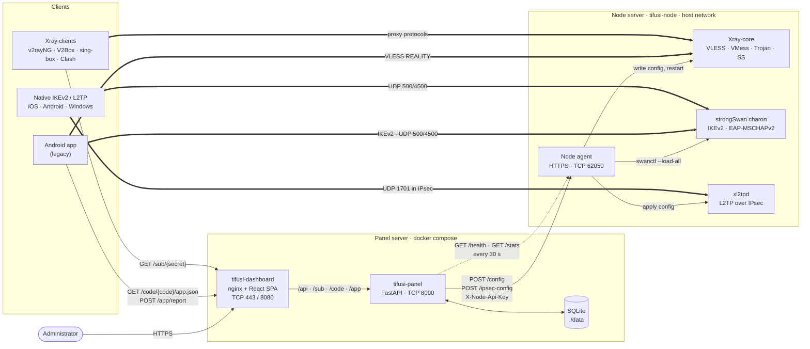
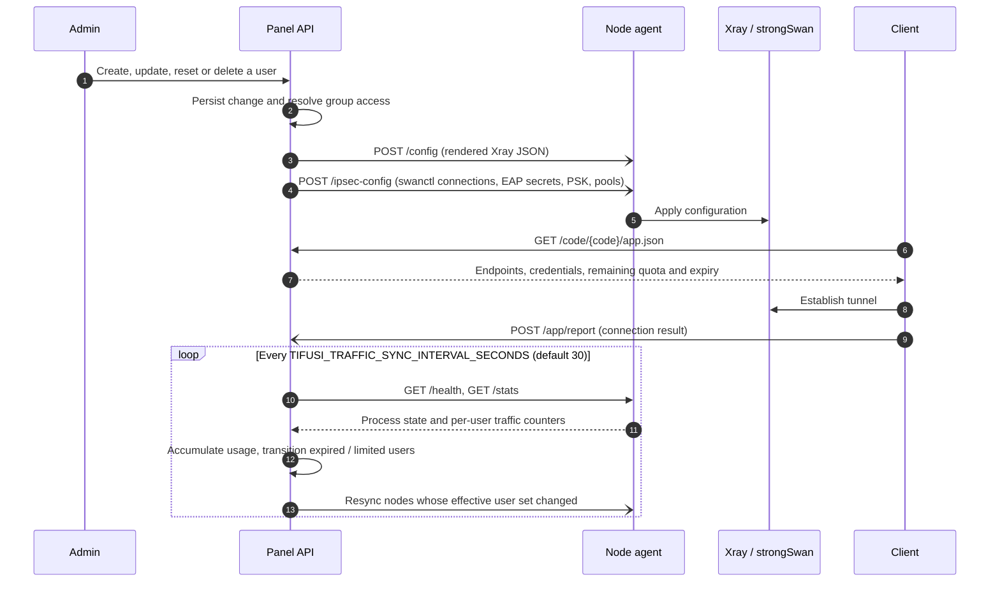

[→ صفحه‌ی اصلی](../../README.fa.md) · 📦 [نصب](installation.md) · 🌐 [نودها](nodes.md) · ⚛️ [هسته‌ها و هاست‌ها](cores-and-hosts.md) · 👤 [کاربران](users-and-subscriptions.md) · 💼 [نمایندگان](resellers.md) · 🚇 [تانل‌ها](tunnels.md) · ✈️ [ربات تلگرام](telegram-bot.md) · 📶 [سلامت شبکه](network-health.md) · 🎛️ [مدیریت](operations.md) · 🔁 [به‌روزرسانی امن](updates-and-rollback.md) · 🚢 [مرجع استقرار](deployment.md) · 📐 **معماری** · 💻 [توسعه](development.md)

# معماری

## اجزا و مسیر داده

فلش‌های پیوسته درخواست‌های لایه‌ی کنترل، فلش‌های نقطه‌چین پایش دوره‌ای و فلش‌های ضخیم ترافیک لایه‌ی داده را نشان می‌دهند. پنل ترافیک کاربران را عبور نمی‌دهد و کلاینت‌ها مستقیماً به نشانی نودهایی که در هاست‌ها منتشر شده‌اند متصل می‌شوند.

## چرخه‌ی همگام‌سازی نود

## اشتراک و API

- مسیرها: `/sub/{secret}` (ساده، Clash یا sing-box بر اساس User-Agent؛ HTML برای مرورگر)، `/app/s/{code}` (‏302 به اشتراک)، `/sub/{secret}/ikev2.mobileconfig`، و `GET /sub/{secret}/app.json` و `/code/{code}/app.json` برای اپ اندروید (`subscription_url` برای دامنه‌ی جدید).
- ویرایش تکی `PUT /api/users/{id}` و گروهی `POST /api/users/bulk-update` قواعد وضعیت یکسان دارند؛ `status` صریح اولویت دارد.
- درخواست روی نشانی پنل با 301 به نشانی اشتراک می‌رود. Remote ID در پروفایل IKEv2 پین است.
- متغیرهای قدیمی نام هاست (`{expire_date}`، `{expire_jalali}`، `{data_left_gb}` و…) هنوز کار می‌کنند.

## به‌روزرسانی امن

| چه چیزی | بررسی قبل از اعمال | نسخه‌ی برگشت |
| --- | --- | --- |
| کانفیگ Xray | `xray run -test` | `<config>.good` |
| کانفیگ strongSwan | `swanctl --load-all` | فایل قبلی |
| باینری تانل | `-version`، `-check` و SHA-256 | `tifusi-tunnel.prev` |
| ایمیج ایجنت نود | کانتینر موقت | `tifusi-node-agent:rollback` |
| پنل | چک سلامت ۹۰ ثانیه‌ای | `tifusi-panel-*:rollback` و `<install>/.rollback/` |

- کانفیگ نود اتمیک نوشته می‌شود (`backend/node_agent/safe_apply.py`)؛ سرویسی که ظرف ۱٫۵ ثانیه کرش کند به نسخه‌ی سالم برمی‌گردد و رد شدن با HTTP 422 به پنل گزارش می‌شود.
- آپدیت تدریجی: Canary ۱۸۰ ثانیه، بقیه ۶۰ ثانیه زیر نظر؛ با کلید SSH پنل وصل می‌شود.
- برگشت پنل اول کد قدیمی را با دیتابیس فعلی امتحان می‌کند؛ اگر بالا نیاید، دیتا از snapshot برمی‌گردد و نوشته‌های بعد از آن از دست می‌رود.

## نودها

- **نصب:** دستور نصب `install-node.sh` را از تگ ریلیزِ هم‌نسخه با پنل می‌گیرد و فقط با SHA-256 درست اجرا می‌کند؛ BBR و بافرهای بزرگ شبکه را فعال می‌کند و کانتینر `tifusi-node` را با `--network host` و `--init` اجرا می‌کند.
- **ارتباط:** HTTPS با گواهی خودامضای پین‌شده و سرآیند `X-Node-Api-Key`. کلید SSH پنل در `data/ssh/id_ed25519` است و کلید میزبان در اتصال اول ثبت می‌شود.
- **همگام‌سازی:** کانفیگ Xray به `POST /config` و IPsec به `POST /ipsec-config` می‌رود؛ هر ۳۰ ثانیه `GET /health` و `GET /stats` خوانده می‌شود. کانفیگ جدید با `xray run -test` بررسی و در صورت خطا برگردانده می‌شود.
- **بسته‌ی آفلاین:** `data/node-bundle/tifusi-node-offline.tar` شامل ایمیج نود، داکر استاتیک، بسته‌های سیستم، باینری تانل و `SHA256SUMS`؛ بعد از هر آپدیت پنل دوباره بسازید.
- **نود جایگزین:** پروفایل با IP ثابت تابع DNS نیست؛ پورت‌های ۸۰ و ۴۴۳ مقصد باید باز بمانند. این قابلیت جای بکاپ پنل را نمی‌گیرد.

## تانل‌ها

- **سازگاری نسخه:** از 1.1.0 هویت رله قبل از اتصال بررسی می‌شود و از 1.2.0 هر stream کنترل جریان دارد؛ هر دو سمت را با هم آپدیت کنید. `udp_raw` حذف شده است.
- **رله‌ی پنهان:** در ترنسپورت‌های WebSocket، هر درخواستی که تانل نباشد یک صفحه‌ی وب معمولی با کد `200` می‌گیرد تا اسکنر رله را تشخیص ندهد.
- **TCP + Stealth:** به اتصال غیرتانل جواب نمی‌دهد و به ساعت هماهنگ دو سرور (اختلاف کمتر از دو دقیقه) نیاز دارد.
- **تست لینک:** روی ایران `tifusi-tunnel linktest serve --port 8443`، روی خارج `tifusi-tunnel linktest run --to <iran-ip> --port 8443`؛ پکت‌لاس، تأخیر و ترنسپورت پیشنهادی را چاپ می‌کند.
- **Spoof:** حامل‌های TCP و ICMP قوانین iptables خود را هنگام اجرا اضافه و هنگام توقف حذف می‌کنند. تست خط فرمان: `tifusi-tunnel spooftest recv|send --proto udp|icmp|icmpv6|tcp`.
- **زنجیره:** N هاپ، N−۱ تانل عادی می‌سازد؛ هاپ میانی ترافیک را روی `127.0.0.1` جابه‌جا می‌کند و فقط پروتکل‌های اشتراک از آن عبور می‌کنند.
- **IKEv2 پشت تانل:** سرور ایران به نشانی خود سرور خارج تحویل می‌دهد، نه `127.0.0.1`؛ پس سمت خارج باید مشخص باشد.
- **آپدیت:** باینری قبلی با نام `tifusi-tunnel.prev` می‌ماند و اگر لینک‌ها ظرف ۴۵ ثانیه برنگردند، برمی‌گردد. لاگ: `journalctl -u tifusi`.

## ساختار مخزن

| Path | Contents |
| --- | --- |
| `backend/app` | FastAPI application: routers, SQLAlchemy models, Xray config builder, subscription renderers, node sync, traffic accounting, network health (`network_health/`) |
| `backend/alembic` | مهاجرت‌های دیتابیس |
| `backend/cli` | ابزار `tifusi-cli`، از جمله ساخت کلید مدیر در اولین اجرا |
| `backend/node_agent` | سرویس ایجنت نود، یکپارچگی strongSwan/xl2tpd، اعتبارسنجی و برگشت کانفیگ (`safe_apply.py`)، Dockerfile نود |
| `backend/app/node_ssh` | نصب، ترمینال و آپدیت Canary نودها با SSH |
| `backend/app/tunnels` | کانفیگ تانل، بسته‌ی آفلاین، نصب و آپدیت با SSH |
| `backend/tests` | تست‌های pytest ([توسعه](development.md)) |
| `backend/tunnel_agent` | ایجنت تانل (Go) |
| `frontend` | داشبورد React و ایمیج nginx |
| `install.sh`, `install-node.sh` | نصب‌کننده‌ی پنل و نود |
| `manage.sh` | منوی مدیریت؛ در `/usr/local/bin/tifusi-panel` نصب می‌شود و با `tifusi panel` اجرا می‌شود |
| `scripts/tifusi` | فرمان مشترک `tifusi` برای پنل، نود و ربات |
| `.github/workflows/tests.yml` | اجرای تست‌ها و بیلد داشبورد با هر push |
| `build-images.yml` (ریپوی عمومی) | اول تست‌ها، بعد ساخت و انتشار ایمیج‌های پنل، داشبورد و نود در GHCR |

داشبورد با React 18، Vite و Tailwind CSS ساخته شده، به فارسی (راست‌به‌چپ) و انگلیسی بومی‌سازی شده و از قلم‌های Vazirmatn و Poppins به‌صورت خودمیزبان استفاده می‌کند.

---

[→ مرجع استقرار](deployment.md) · [توسعه ←](development.md)

