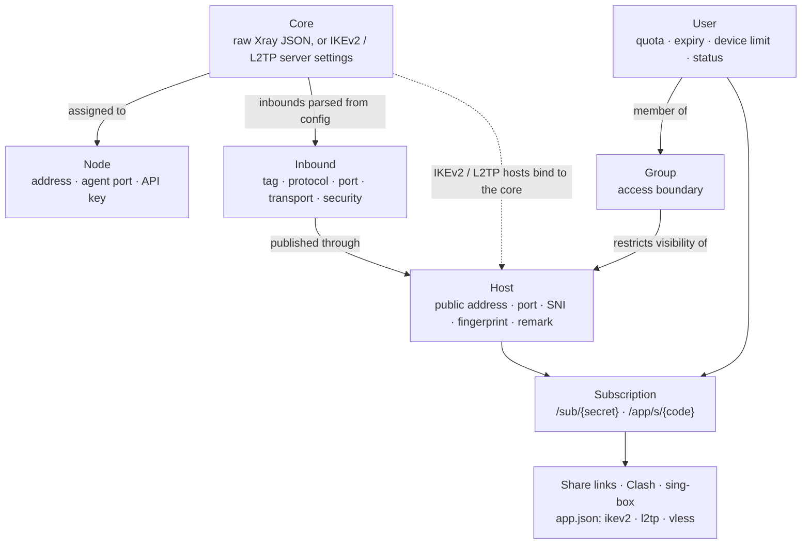

[→ صفحه‌ی اصلی](../../README.fa.md) · 📦 [نصب](installation.md) · 🌐 [نودها](nodes.md) · ⚛️ **هسته‌ها و هاست‌ها** · 👤 [کاربران](users-and-subscriptions.md) · 💼 [نمایندگان](resellers.md) · 🚇 [تانل‌ها](tunnels.md) · 🛡️ [سپر اتصال](connection-shield.md) · 🔀 [چرخش دامنه](domain-rotation.md) · ✈️ [ربات تلگرام](telegram-bot.md) · 📶 [سلامت شبکه](network-health.md) · 🎛️ [مدیریت](operations.md) · 🔁 [به‌روزرسانی امن](updates-and-rollback.md) · 🚢 [مرجع استقرار](deployment.md) · 📐 [معماری](architecture.md) · 💻 [توسعه](development.md)

# هسته‌ها، هاست‌ها و گروه‌ها

> **پس از نصب در دسترس:** Xray، IKEv2، L2TP، PPTP، Hysteria2 و WireGuard. برای اجرای سرویس، هسته را بسازید و به نود اختصاص دهید؛ نصب به‌تنهایی نقطه اتصال VPN ایجاد نمی‌کند.

## مدل پیکربندی

## هسته‌ها

هسته فناوری سمت سروری است که روی نود اجرا می‌شود. استقرار پیش‌فرض از این نوع‌ها استفاده می‌کند:

| نوع | محتوا |
| --- | --- |
| `xray` | یک پیکربندی کامل Xray به‌صورت JSON، دقیقاً همان چیزی که `xray run -c` می‌پذیرد، همراه با ویرایشگرهای ساخت‌یافته برای routing، outbounds و DNS. inboundهای آن استخراج شده و برای هاست‌ها و گروه‌ها قابل انتخاب می‌شوند. |
| `ikev2` | پارامترهای سرور IKEv2/IPsec: حالت احراز هویت (EAP-MSCHAPv2 یا PSK)، شناسه‌ی راه دور (Remote ID) و گواهی سرور. |

هر هسته را می‌توان به یک یا چند نود تخصیص داد. هر نود هم‌زمان یک هسته‌ی Xray و یک هسته‌ی IPsec دارد؛ بخش [دو هسته روی یک نود](nodes.md) را ببینید.

هسته‌ای که inbound (یا پورت Hysteria2 یا WireGuard) آن روی پورتی باشد که چیزی روی نود از قبل استفاده می‌کند — پورت ایجنت هر نود، SSH (22) یا APIهای داخلی آمار ایجنت — ذخیره نمی‌شود؛ [پورت‌های رزرو](updates-and-rollback.md) را ببینید.

## هاست‌ها

هاست نقطه‌ی اتصال عمومی است که کلاینت دریافت می‌کند: نشانی، پورت و نام نمایشی، برای VLESS، VMess، Trojan، Shadowsocks، Hysteria2، L2TP و IKEv2.

- **پروتکل‌های Xray** به یک inbound استخراج‌شده از پیکربندی هسته ارجاع می‌دهند و پارامترهای transport، security و REALITY را از آن به ارث می‌برند. SNI، ALPN، fingerprint، path و security را می‌توان برای کلاینت‌ها بازنویسی کرد.
- هاست‌های **L2TP** به یک هسته‌ی `l2tp` متصل می‌شوند و از PSK مشترک آن استفاده می‌کنند.
- هاست‌های **IKEv2** به یک هسته‌ی `ikev2` متصل می‌شوند. سرور با گواهی X.509 (به‌طور پیش‌فرض خودامضا، یا زنجیره‌ی صادرشده توسط CA) و هر کاربر با EAP-MSCHAPv2 احراز هویت می‌شود.
- **Hysteria2** پردازش جداگانه‌ای در ایجنت نود دارد؛ [راهنمای Hysteria2](hysteria2.md) را ببینید.
- **استخر دامنه** (VLESS، VMess، Trojan، Shadowsocks و Hysteria2): هاست به ازای هر دامنه‌ی سالم استخر یک بار در اشتراک می‌رود و دامنه‌های فیلترشده خودکار جایگزین می‌شوند — [چرخش دامنه](domain-rotation.md).

چند هاست روی یک inbound از Xray در واقع نسخه‌های مختلف لینک برای همان یک inbound سمت سرور هستند، برای همین صفحه‌ی **هاست‌ها** آن‌ها را در یک کارت جمع می‌کند — هم‌اندازه‌ی بقیه‌ی کارت‌ها، با همان سیگنال، پینگ و نمودار کوچک — که عنوانش تگ inbound و تعداد لینک‌هاست. با باز کردن کارت، هر هاست با همان دکمه‌های همیشگی‌اش دیده می‌شود.

### متغیرهای پویا در نام هاست (ریمارک)

داخل کادر نام هاست یک دکمه‌ی دایره‌ای `{ }` منوی متغیرها را باز می‌کند؛ با کلیک، متغیر در محل نشانگر درج می‌شود تا بشود چند متغیر را با متن دلخواه ترکیب کرد (مثلاً `🇩🇪 {server_name} | {username} - {days_left} روز`). لینک‌ها و همه‌ی فرمت‌های اشتراک برای هر کاربر با مقدار خودش پر می‌شوند:

| متغیر | مقدار |
| --- | --- |
| `{username}` | نام کاربر |
| `{protocol}` | VLESS، VMess، Trojan، Shadowsocks، Hysteria2، IKEv2، L2TP… |
| `{expiry_date_en}` / `{expiry_date_fa}` | تاریخ انقضا، میلادی / شمسی |
| `{days_left}` | روزهای باقی‌مانده |
| `{used_traffic}` / `{remaining_traffic}` / `{total_traffic}` | با واحد؛ نامحدود `∞` |
| `{server_name}` / `{node_name}` | نودهایی که هسته‌ی این هاست را اجرا می‌کنند |
| `{status}` | فعال / منقضی / تمام‌شده |

ریمارک‌هایی که با اسم‌های قبلی متغیرها نوشته شده‌اند (`{expire_date}`، `{expire_jalali}`، `{data_limit_gb}`، `{data_left_gb}`، `{data_used_gb}`) مثل قبل کار می‌کنند.

### تنظیم REALITY

پارامترهای REALITY از جمله `serverNames`، `dest`، کلیدها و تنظیمات سمت کلاینت را در JSON هسته‌ی Xray وارد کنید. هاست مقادیر inbound را به ارث می‌برد و بازنویسی‌های مجاز سمت کلاینت همان موارد بالاست.

اسکنر تارگت و دکمه‌ی **پیدا کردن بهترین تارگت (SNI)** حذف شده‌اند و مسیرهای اسکن `/api/reality` دیگر در پنل فعال نیستند. اتصال REALITY و تنظیم دستی آن برقرار است و به اسکنر یا دانلود پروب نیاز ندارد.

## گروه‌ها

گروه‌ها کنترل دسترسی واقعی‌اند، نه صرفاً دسته‌بندی. هاست یا inbound بدون گروه برای همه‌ی کاربران قابل مشاهده است. پس از اتصال به یک یا چند گروه، فقط برای اعضای همان گروه‌ها در اشتراک و در پیکربندی نود درج می‌شود؛ بنابراین عضویت در گروه هم لینک‌های دریافتی کاربر و هم اعتبارنامه‌های ارسالی به نودها را تعیین می‌کند.

هاست VLESS، VMess، Trojan یا Shadowsocks می‌تواند علاوه بر گروه‌های inbound، گروه‌های مخصوص خودش را هم داشته باشد: فقط اعضای آن گروه‌ها لینک آن هاست را می‌گیرند، در حالی که کلاینت‌های روی نود تغییری نمی‌کنند. این برای امتحان یک نسخه‌ی دیگر از لینک (پورت دیگر CDN، آی‌پی تمیز، Fragment) روی چند کاربر قبل از همه ساخته شده است. صفحه‌ی گروه‌ها همه‌ی هاست‌ها را نشان می‌دهد و صفحه‌ی هاست‌ها گروه‌های اختصاصی هر هاست را با 🔒 مشخص می‌کند.

---

[→ نودها](nodes.md) · [کاربران ←](users-and-subscriptions.md)

